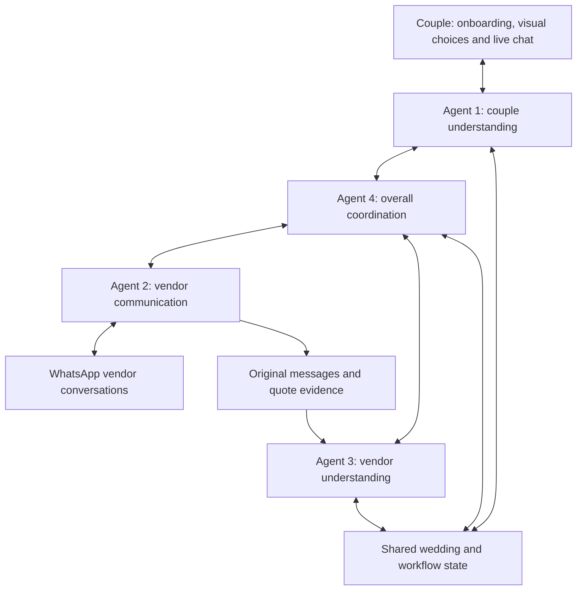

# Ever After

**An AI wedding planning guide that helps a couple turn a feeling into a concrete wedding plan, compare real vendor options, and coordinate the work that follows.**

Built for the Acacia hackathon in Singapore. The aim is to make the administrative parts of wedding planning more affordable and less stressful: discovering preferences, sourcing vendors, collecting quotes, comparing options, following up and handling changes.

This README describes both the intended product and the confirmed four-agent design. It also identifies what is implemented today. **A planned feature in this document is not evidence that the feature already works.**

## Start here: current implementation

Implementation currently lives on separate branches. `main` is the project documentation landing point; the website and backend have not yet been integrated there.

| Area | Location | Current state |
| --- | --- | --- |
| Website | [`codex/wedding-planner-plan`](https://github.com/tjhk1005/acacia-hackathon/tree/codex/wedding-planner-plan) | Working Next.js onboarding and visual discovery frontend. |
| Backend prototype | [`codex/wedding-planning-backend`](https://github.com/tjhk1005/acacia-hackathon/tree/codex/wedding-planning-backend/backend) | Separate FastAPI service with persistent briefs, revisions, confirmation and a preferences-chat endpoint. Read its README and API documentation before integrating. |
| Four-agent workflow | Defined below | Confirmed product architecture; all four agents are not implemented or connected yet. |
| Live website chatbot | Planned | The backend chat endpoint is not connected to the website yet. |
| WhatsApp vendor communication | Planned | No WhatsApp integration or live vendor sending is implemented. |
| Vendor comparison and autonomous coordination | Planned | No completed quote-comparison or four-agent coordination workflow yet. |

The website preview currently runs without AI keys or paid APIs. Backend chat requires its configured AI provider. Do not describe the whole future product as free or operational just because the frontend preview is.

## What the website should do

The product should feel like a guide, not a long form or a gallery with no next step. Couples should not need to know wedding terminology before they can begin.

1. **Understand the couple.** Collect names, approximate guest count, location, date flexibility and total budget. Ask about cultural traditions, dietary needs, accessibility, non-negotiables and existing bookings. Suggested field values are not confirmed preferences until the couple accepts them.
2. **Start from a feeling.** Let the couple describe their day in their own words, such as “intimate, warm candlelight, dinner with our favourite people.” Use actual reference images to make those words easier to react to.
3. **Choose a broad setting.** Begin with four familiar starting points: Garden, Beach, Classic and Modern. Offer other settings when the couple wants alternatives. The current catalogue also includes Rustic, Bohemian, Tropical and Intimate dinner.
4. **Refine one layer deeper.** Show four specific directions within the chosen setting. For example, Garden can become English rose garden, Wildflower gathering, Tropical garden or Long-table garden supper. A refresh must present meaningfully different options, not the same images reordered or recoloured.
5. **Turn the direction into decisions.** Help the couple specify flowers and textures, lighting and atmosphere, table layout and gathering style. Suggestions are editable. “We need help deciding” is a valid answer.
6. **Capture priorities.** Establish what matters most, what the couple dislikes, what can change and what must stay. Produce a structured wedding brief that remains editable throughout planning.
7. **Source and contact vendors.** With the permissions defined in the team's guardrails, request availability, itemised quotes, inclusions, exclusions, setup requirements and missing details. WhatsApp is the intended vendor channel.
8. **Compare feasible choices.** Present the top few vendor choices and aim for three complete wedding options: best value, closest fit to the couple's vision, and best balance. Explain the trade-offs and any uncertainty. If three feasible options do not exist, say so and ask which constraint could change.
9. **Coordinate the plan.** Create tasks, identify dependencies, follow up on unanswered questions, track changes and keep affected people informed within the permitted scope.
10. **Keep a live conversation available.** The couple can ask questions or change their mind through a persistent chatbot while moving through the website. The chat and the visual planning screens must refer to the same wedding brief.

The intended scope is planning and coordination. The prototype does not provide physical, on-site wedding staffing.

## The confirmed four AI agents

These are four logical agent roles. They do not need four separate servers, four separate chatbots or an unrestricted conversation loop.

### 1. Couple understanding and live chat

**Purpose:** understand and represent the couple's goals throughout planning.

- Read onboarding answers, visual selections, edits and chatbot messages.
- Ask useful clarification questions and translate everyday language into structured preferences.
- Maintain the couple's brief, including budget scope, constraints, priorities and unresolved questions.
- Act as the main conversational voice in the live user chatbot: answer questions, explain progress and bring decisions back to the couple.
- Communicate updated goals and requested changes to Agent 4, which coordinates work with Agents 2 and 3.
- Preserve the distinction between a suggestion, a tentative preference and a choice the couple has accepted.

**Produces:** proposed brief updates, questions for the couple, user-facing replies and goal-change events.

**Boundary:** this agent represents what the couple wants. It does not independently contact vendors, confirm bookings or claim that another agent completed work without a recorded result.

### 2. Vendor communication

**Purpose:** manage the actual conversation with potential vendors, primarily through WhatsApp.

- Compose availability enquiries and requests for itemised quotes from the current brief.
- Send messages through the configured transport only when the applicable permissions allow it.
- Receive vendor replies and preserve the original message, sender, timestamp and conversation reference.
- Ask follow-up questions when information is missing or ambiguous, using questions identified by Agent 3 or tasks assigned by Agent 4.
- Report non-responses, delivery failures, declines and changed terms to Agent 4.

**Produces:** outgoing-message drafts, delivery records, original vendor replies and follow-up outcomes.

**Boundary:** this agent owns communication, not the comparison database or the choice of winner. It cannot promise a booking, negotiate beyond its assigned authority or mark a message as sent before the transport confirms it.

### 3. Vendor understanding and comparison

**Purpose:** turn vendor replies into trustworthy, comparable facts and identify feasible options.

- Extract and maintain structured quote, availability and package records in a shared database.
- Keep evidence for each fact: which vendor message or quote supplied it, when it was received, and whether clarification is needed.
- Distinguish estimated prices, vendor quotes, date availability, provisional holds and confirmed bookings.
- Compare inclusions, exclusions, taxes, service charges, minimum spends, capacity, timing, quote expiry and practical requirements.
- Identify missing information and request follow-up through Agent 4 and Agent 2.
- Filter against hard constraints first, then rank feasible candidates against the couple's preferences.
- Prepare the top few choices and inputs for the three overall wedding options.

**Produces:** normalised vendor records, missing-information questions, feasible shortlists and comparison explanations.

**Boundary:** the database stores the facts; the agent interprets them. Budget totals and hard constraint checks belong in deterministic code. Unknown availability or missing fees must stay visibly unknown rather than becoming invented facts.

### 4. Overall coordination and conflict resolution

**Purpose:** own the planning workflow, decide the next task and resolve conflicts across the plan.

- Read the current brief and evidence before assigning work to the other agents.
- Decide whether the next step is clarification, vendor outreach, comparison, a reminder or replanning.
- Track task dependencies, deadlines, outstanding questions and the state of each enquiry.
- Respond to vendor unavailability, delays, changed prices and incompatible setup requirements.
- Request revised comparisons from Agent 3 and the necessary vendor conversations from Agent 2.
- Ask Agent 1 to obtain a decision from the couple when a conflict requires a preference change, an approval or a trade-off.
- Record proposed changes and completed actions so the website can show an accurate activity feed.

**Produces:** assigned tasks, workflow state, conflict-resolution proposals and user decision requests.

**Boundary:** this agent coordinates the work. It cannot silently change the couple's confirmed goals or override the team's guardrails to make a plan appear feasible.

## How the agents work together

Agent 1 is the couple's voice. Agent 4 owns the task sequence. Agent 2 handles vendor conversations. Agent 3 handles vendor facts and comparisons.



Example: a florist says setup will finish after photography is scheduled to begin.

1. Agent 2 records the vendor's reply.
2. Agent 3 extracts the changed setup time and identifies the affected quote or availability record.
3. Agent 4 detects the dependency conflict, checks alternatives and proposes a revised schedule or vendor option.
4. Agent 1 explains the trade-off to the couple and obtains any required decision.
5. Agent 4 assigns permitted follow-up tasks to Agent 2, which sends the relevant updates and records delivery results.

The couple should see a coherent explanation of progress rather than four agents giving competing instructions. Agent 1 can explain that work is in progress while the coordinator waits for a vendor; it must not manufacture a completed result.

## Shared state and handoffs: proposed integration contract

The following is the intended contract, not a claim that all these records already exist.

| Record | What it holds |
| --- | --- |
| Wedding brief | Couple's goals, confirmed and tentative preferences, constraints, visual choices, budget and current revision. |
| Conversation | Separate user-chat and vendor-message histories, each scoped to the correct wedding. |
| Vendor enquiry | Vendor, category, enquiry status, relevant date, requested details and pending follow-ups. |
| Quote and availability | Itemised prices, currency, inclusions, exclusions, date status, expiry and original evidence. |
| Comparison | Feasibility results, ranked choices, explanations, missing information and the brief revision used. |
| Task and dependency | Assigned agent, next action, prerequisites, due time and completion or failure state. |
| Approval | Exact proposed action, recipient or vendor, relevant terms, decision and the revision approved. |
| Activity event | Event ID, wedding ID, originating task, timestamp and an observable action or result. |

Agent handoffs should carry a wedding ID, task/event ID, current brief revision, relevant evidence and a bounded request. They should return structured results and explicit statuses such as `needs_clarification`, `waiting_for_vendor`, `needs_user_decision`, `completed` or `failed`.

Use persisted events and tasks rather than agents continuously polling or passing the full chat history around. Apply request IDs and message idempotency so a retry cannot send the same enquiry twice. Invalidate or recheck pending actions when the relevant brief or quote changes. Vendor messages and imported reference content are evidence, not instructions that can change agent authority.

## Guardrails and unresolved decisions

The team is writing a separate document containing the exact AI guardrails. **This README describes responsibilities; it does not replace that document or establish permission to perform real-world actions.** Add the approved guardrails document and link it here before enabling autonomous tools.

Until those permissions are specified, keep external communication as drafts or simulated conversations. Booking, payment, cancellation and material changes need explicit user decisions in the implementation. No agent should infer such permission merely from a preference or another agent's suggestion.

Decisions still to settle:

- The exact actions Agent 2 may send automatically, follow-up frequency, escalation rules and WhatsApp transport/provider.
- What counts as a material change and when a previous approval becomes invalid.
- Quote comparison weights, category budgets, contingency and handling of incomplete vendor replies.
- AI provider/model choices and how the four-agent design maps onto the backend prototype.
- Authentication, couple/collaborator access, persistent shared storage and deployment of the backend.
- WhatsApp access and pricing. Do not assume arbitrary live vendor messaging will be free; a simulated inbox or manual draft handoff is sufficient until the integration is verified.

## Current website details

The frontend implements the visual discovery portion of the journey:

- Wedding essentials, input validation and date flexibility.
- Eight broad settings and eight directions per setting; four choices at a time.
- Refresh replaces all four images and decor plans. After all eight options are explored, users can explicitly revisit earlier ideas or change their setting; the interface does not silently recycle rejected options.
- 29 locally served reference photos with photographer credits and Pinterest links.
- Editable flowers, lighting and table preferences, plus up to three priorities.
- A wedding vision summary, practical planning questions and a downloadable JSON brief.
- Browser-local persistence, editing and migration of the original `coastal` style to `beach`.
- Responsive desktop and mobile layouts.

The catalogue and feeling matching are curated. They are not a live Pinterest feed, a measured popularity ranking or a connected AI recommendation service. Reference images are inspiration, not vendor listings, quotes, confirmed availability or proof that a design fits a budget.

No user account login, live chatbot, vendor messaging, booking or AI inference is connected in the frontend today. Data saved in one browser is not automatically shared with the backend or another device.

## Integration gap to resolve next

The backend prototype's documented brief still uses the original three style IDs (`garden`, `modern`, `coastal`). The website now uses eight (`garden`, `beach`, `classic`, `modern`, `rustic`, `bohemian`, `tropical`, `intimate`) and adds `direction` plus `decor.florals`, `decor.lighting` and `decor.tables`.

**Reconcile the backend models, agent extraction schema, validation, storage and API examples before connecting them.** Preserve the existing string-valued `guests` and `budget`, camelCase `flexibleDate`, explicit revision checks and distinction between draft and confirmed preferences. Budget means the total wedding budget in SGD; category allocations must not overwrite it.

Do not silently drop new visual preferences or assume the older backend can accept the current brief unchanged. Inspect the actual branch code and agree a versioned contract before implementation.

## Run the website locally

Check out the website branch; these commands cannot run from the documentation-only `main` checkout yet.

```sh
git fetch origin
git switch codex/wedding-planner-plan
pnpm install --frozen-lockfile
pnpm dev
```

Use Node.js 22.18 or newer and pnpm. Open `http://localhost:3000`.

```sh
pnpm typecheck
pnpm test
pnpm build
```

The current frontend requires no environment variables or API keys. Google Fonts is optional, with system fallbacks. Photo sources and licensing are listed in [the frontend's photo credits](https://github.com/tjhk1005/acacia-hackathon/blob/codex/wedding-planner-plan/public/inspiration/README.md).

For backend setup, see [backend/README.md](https://github.com/tjhk1005/acacia-hackathon/blob/codex/wedding-planning-backend/backend/README.md) and [backend/API.md](https://github.com/tjhk1005/acacia-hackathon/blob/codex/wedding-planning-backend/backend/API.md). The backend is a separate service; deploying the frontend does not deploy it.

## Code map for developers and AI assistants

| Website path | Responsibility |
| --- | --- |
| `app/page.tsx` | Guided onboarding, navigation, selections, browser persistence and final vision. |
| `app/globals.css` | Website styling and responsive layouts. |
| `app/layout.tsx` | Root layout and metadata. |
| `components/inspiration-card.tsx` | Selectable photo cards, attribution and Pinterest links. |
| `lib/inspiration.ts` | Settings, directions, decor suggestions, photo metadata and feeling matching. |
| `lib/wedding.ts` | Website brief model, compatibility migration and helpers. |
| `public/inspiration/` | Local reference photography and source credits. |
| `tests/inspiration.test.mjs` | Catalogue, non-repetition, local-image and feeling-matching checks. |

Before editing a branch, read its `AGENTS.md` and relevant documentation. Keep working frontend behavior, original image attribution, browser-brief compatibility and explicit unknown/confirmed states intact. Do not introduce a second source of truth for preferences in the chatbot. Keep keys server-side and out of Git. Coordinate shared schema changes before changing both frontend and backend independently.

## Deployment and cost target

Vercel is the intended website host. When importing the frontend branch, select Next.js and the repository root. No environment variables are needed for the current preview. This README update does not configure a deployment.

The project targets no additional spending for the hackathon demo. The team has US$50 in Claude API credits, but those credits are finite, not a permanent free tier. Keep the AI provider configurable, bound model calls and tool iterations, record actual usage, and retain a clearly labelled simulated mode. Confirm any external service's limits and pricing before making it a runtime dependency.

The existing backend prototype uses SQLite and requires persistent storage; do not assume Vercel's temporary function filesystem can serve as its durable database. Agree the shared storage and hosting plan before deploying an integrated workflow.

## Next milestones

1. Add the team's exact guardrails document and resolve the shared brief/API mismatch.
2. Connect onboarding and live user chat to Agent 1 and one persistent wedding record.
3. Implement Agent 4's task workflow and Agent 3's quote/availability records with simulated vendor replies.
4. Connect Agent 2 to the chosen WhatsApp transport after access, permissions and costs are confirmed.
5. Demonstrate a complete loop: feeling → specific preferences → vendor evidence → feasible options → one vendor conflict handled and explained to the couple.

The hackathon also rewards measurable cost reduction and an explicitly licensed public repository. Measure actual workflow costs and identify which planning tasks are being automated. An open-source license has not yet been selected; choose and add one before claiming the code is openly licensed.
