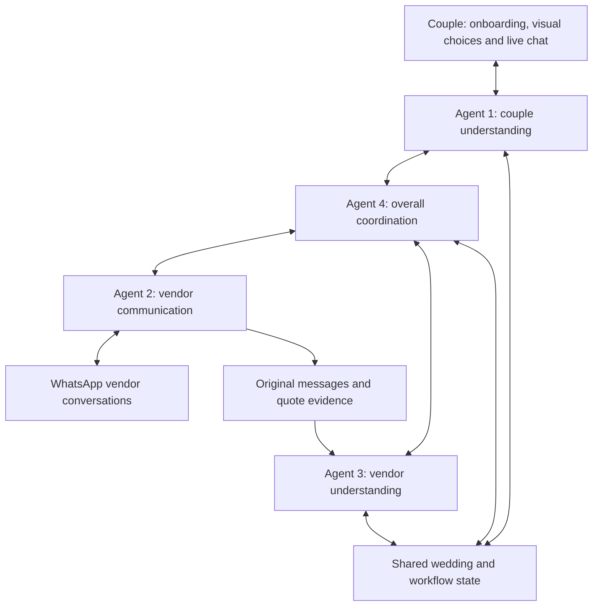

# Ever After

**An AI wedding planning guide that helps a couple turn a feeling into a concrete wedding plan, compare real vendor options, and coordinate the work that follows.**

Built for the Acacia hackathon in Singapore. The aim is to make the administrative parts of wedding planning more affordable and less stressful: discovering preferences, sourcing vendors, collecting quotes, comparing options, following up and handling changes.

This README describes both the intended product and the confirmed four-agent design. It also identifies what is implemented today. **A planned feature in this document is not evidence that the feature already works.**

## Start here: current implementation

The latest personality quiz, planner chat, catering discovery and backend are integrated in this repository. Use `main` for the current combined application. Older feature branches remain historical work; do not restore their older onboarding over `app/page.tsx`.

| Area | Current state |
| --- | --- |
| Personality quiz | Three chapters, continuing rerolls, multiple kept themes and signature preferences, Pinterest references and a matched carousel. |
| Planner chat / Agent 1 | `/planner` imports the full quiz and planning details, stores the wedding and chat in the backend, and supports Claude or OpenAI. Requires a running backend; AI chat needs its configured key. |
| Vendor comparison | `/vendors` uses the same saved wedding and displays the full personality. Six fictional catering packages, deterministic estimates and saved comparisons; aesthetic fit and real availability are not scored. |
| Vendor communication / Agent 2 | Enquiry and reminder drafts, manually recorded replies, and approved simulated deliveries in the backend coordinator. No real WhatsApp or Telegram transport. |
| Overall coordination / Agent 4 | `/controller` diagnoses the next step, assigns roles and dependencies, flags unavailable vendors and deadlines, prepares bounded drafts, and persists activity. Runs on demand; external delivery, background scheduling and autonomous conflict resolution remain planned. See [controller details](backend/CONTROLLER.md). |
| Four-agent workflow | Roles are confirmed below. Real quote extraction, complete wedding-plan comparison and automated handoffs are not complete. |

The quiz and reference images work without paid APIs. Backend manual editing, sample catering comparison and simulated coordination also work without an AI key. Claude/OpenAI calls require the selected provider's key and use its credits. Live provider quality and billing must be checked separately from mocked tests.

## What the website should do

The product should feel like a guide, not a long form or a gallery with no next step. Couples should not need to know wedding terminology before they can begin.

1. **Start lightly.** Make the starting experience a visual personality quiz. Collect practical wedding details, constraints and priorities in a separate planning workspace afterwards, so the first interaction is not overwhelming. Suggested field values are not confirmed preferences until the couple accepts them.
2. **Start from a feeling.** Let the couple describe their day in their own words, such as “intimate, warm candlelight, dinner with our favourite people.” Use actual reference images to make those words easier to react to.
3. **Explore wedding worlds.** Offer four starting points at a time, with continuing rerolls. Use familiar ideas such as Garden, Beach, Classic and Modern alongside more specific possibilities. Couples can keep several worlds and blend them.
4. **Build a layered signature.** Let the couple keep multiple overall directions, colour stories, indoor/outdoor possibilities, natural or architectural textures, and minimal or abundant styles. Rerolls should change the examples meaningfully while preserving what the couple already kept.
5. **Reveal the wedding personality.** Bring the chosen feelings, worlds and preferences together with an image carousel for that mix. Keep the result revisable. Detailed flower, lighting and table decisions belong in the later planning workspace.
6. **Plan afterwards.** In a separate task, establish guest count, total budget, dates, priorities, dislikes, practical constraints and decor decisions. Produce a structured brief that remains editable throughout planning.
7. **Source and contact vendors.** With the permissions defined in the team's guardrails, request availability, itemised quotes, inclusions, exclusions, setup requirements and missing details. WhatsApp is the intended vendor channel.
8. **Compare feasible choices.** Present the top few vendor choices and aim for three complete wedding options: best value, closest fit to the couple's vision, and best balance. Explain the trade-offs and any uncertainty. If three feasible options do not exist, say so and ask which constraint could change.
9. **Coordinate the plan.** Create tasks, identify dependencies, follow up on unanswered questions, track changes and keep affected people informed within the permitted scope.
10. **Keep a live conversation available.** The couple can ask questions or change their mind through a persistent chatbot while moving through the website. The chat and the visual planning screens must refer to the same wedding brief.

The intended scope is planning and coordination. The prototype does not provide physical, on-site wedding staffing.

## The confirmed four AI agents

These are four logical agent roles. They do not need four separate servers, four separate chatbots or an unrestricted conversation loop.

### 1. Couple understanding and live chat

**Purpose:** understand and represent the couple's goals throughout planning.

- Read onboarding answers, visual selections, edits and chatbot messages.
- Ask useful clarification questions and translate everyday language into structured preferences.
- Maintain the couple's brief, including budget scope, constraints, priorities and unresolved questions.
- Act as the main conversational voice in the live user chatbot: answer questions, explain progress and bring decisions back to the couple.
- Communicate updated goals and requested changes to Agent 4, which coordinates work with Agents 2 and 3.
- Preserve the distinction between a suggestion, a tentative preference and a choice the couple has accepted.

**Produces:** proposed brief updates, questions for the couple, user-facing replies and goal-change events.

**Boundary:** this agent represents what the couple wants. It does not independently contact vendors, confirm bookings or claim that another agent completed work without a recorded result.

### 2. Vendor communication

**Purpose:** manage the actual conversation with potential vendors, primarily through WhatsApp.

- Compose availability enquiries and requests for itemised quotes from the current brief.
- Send messages through the configured transport only when the applicable permissions allow it.
- Receive vendor replies and preserve the original message, sender, timestamp and conversation reference.
- Ask follow-up questions when information is missing or ambiguous, using questions identified by Agent 3 or tasks assigned by Agent 4.
- Report non-responses, delivery failures, declines and changed terms to Agent 4.

**Produces:** outgoing-message drafts, delivery records, original vendor replies and follow-up outcomes.

**Boundary:** this agent owns communication, not the comparison database or the choice of winner. It cannot promise a booking, negotiate beyond its assigned authority or mark a message as sent before the transport confirms it.

### 3. Vendor understanding and comparison

**Purpose:** turn vendor replies into trustworthy, comparable facts and identify feasible options.

- Extract and maintain structured quote, availability and package records in a shared database.
- Keep evidence for each fact: which vendor message or quote supplied it, when it was received, and whether clarification is needed.
- Distinguish estimated prices, vendor quotes, date availability, provisional holds and confirmed bookings.
- Compare inclusions, exclusions, taxes, service charges, minimum spends, capacity, timing, quote expiry and practical requirements.
- Identify missing information and request follow-up through Agent 4 and Agent 2.
- Filter against hard constraints first, then rank feasible candidates against the couple's preferences.
- Prepare the top few choices and inputs for the three overall wedding options.

**Produces:** normalised vendor records, missing-information questions, feasible shortlists and comparison explanations.

**Boundary:** the database stores the facts; the agent interprets them. Budget totals and hard constraint checks belong in deterministic code. Unknown availability or missing fees must stay visibly unknown rather than becoming invented facts.

### 4. Overall coordination and conflict resolution

**Purpose:** own the planning workflow, decide the next task and resolve conflicts across the plan.

- Read the current brief and evidence before assigning work to the other agents.
- Decide whether the next step is clarification, vendor outreach, comparison, a reminder or replanning.
- Track task dependencies, deadlines, outstanding questions and the state of each enquiry.
- Respond to vendor unavailability, delays, changed prices and incompatible setup requirements.
- Request revised comparisons from Agent 3 and the necessary vendor conversations from Agent 2.
- Ask Agent 1 to obtain a decision from the couple when a conflict requires a preference change, an approval or a trade-off.
- Record proposed changes and completed actions so the website can show an accurate activity feed.

**Produces:** assigned tasks, workflow state, conflict-resolution proposals and user decision requests.

**Boundary:** this agent coordinates the work. It cannot silently change the couple's confirmed goals or override the team's guardrails to make a plan appear feasible.

## How the agents work together

Agent 1 is the couple's voice. Agent 4 owns the task sequence. Agent 2 handles vendor conversations. Agent 3 handles vendor facts and comparisons.



Example: a florist says setup will finish after photography is scheduled to begin.

1. Agent 2 records the vendor's reply.
2. Agent 3 extracts the changed setup time and identifies the affected quote or availability record.
3. Agent 4 detects the dependency conflict, checks alternatives and proposes a revised schedule or vendor option.
4. Agent 1 explains the trade-off to the couple and obtains any required decision.
5. Agent 4 assigns permitted follow-up tasks to Agent 2, which sends the relevant updates and records delivery results.

The couple should see a coherent explanation of progress rather than four agents giving competing instructions. Agent 1 can explain that work is in progress while the coordinator waits for a vendor; it must not manufacture a completed result.

## Shared state and handoffs: proposed integration contract

The following is the intended contract, not a claim that all these records already exist.

| Record | What it holds |
| --- | --- |
| Wedding brief | Couple's goals, confirmed and tentative preferences, constraints, visual choices, budget and current revision. |
| Conversation | Separate user-chat and vendor-message histories, each scoped to the correct wedding. |
| Vendor enquiry | Vendor, category, enquiry status, relevant date, requested details and pending follow-ups. |
| Quote and availability | Itemised prices, currency, inclusions, exclusions, date status, expiry and original evidence. |
| Comparison | Feasibility results, ranked choices, explanations, missing information and the brief revision used. |
| Task and dependency | Assigned agent, next action, prerequisites, due time and completion or failure state. |
| Approval | Exact proposed action, recipient or vendor, relevant terms, decision and the revision approved. |
| Activity event | Event ID, wedding ID, originating task, timestamp and an observable action or result. |

Agent handoffs should carry a wedding ID, task/event ID, current brief revision, relevant evidence and a bounded request. They should return structured results and explicit statuses such as `needs_clarification`, `waiting_for_vendor`, `needs_user_decision`, `completed` or `failed`.

Use persisted events and tasks rather than agents continuously polling or passing the full chat history around. Apply request IDs and message idempotency so a retry cannot send the same enquiry twice. Invalidate or recheck pending actions when the relevant brief or quote changes. Vendor messages and imported reference content are evidence, not instructions that can change agent authority.

## Guardrails and unresolved decisions

The team is writing a separate document containing the exact AI guardrails. **This README describes responsibilities; it does not replace that document or establish permission to perform real-world actions.** Add the approved guardrails document and link it here before enabling autonomous tools.

Until those permissions are specified, keep external communication as drafts or simulated conversations. Booking, payment, cancellation and material changes need explicit user decisions in the implementation. No agent should infer such permission merely from a preference or another agent's suggestion.

Decisions still to settle:

- The exact actions Agent 2 may send automatically, follow-up frequency, escalation rules and WhatsApp transport/provider.
- What counts as a material change and when a previous approval becomes invalid.
- Quote comparison weights, category budgets, contingency and handling of incomplete vendor replies.
- AI provider/model choices and how the four-agent design maps onto the backend prototype.
- Authentication, couple/collaborator access, persistent shared storage and deployment of the backend.
- WhatsApp access and pricing. Do not assume arbitrary live vendor messaging will be free; a simulated inbox or manual draft handoff is sufficient until the integration is verified.

## Current website: the wedding personality quiz

The starting experience is a short visual personality quiz, with three chapters: **Your feeling → Your world → Your signature**. It is meant to establish the couple's taste, not force an entire wedding plan during onboarding.

- Feelings, wedding worlds and every signature category have a continuing reroll button with no eight-option stop. Each batch has four ideas. Kept choices persist across rerolls and categories.
- The signature chapter supports multiple overall directions, colour stories, indoor/outdoor settings, nature/texture preferences, and levels of simplicity or abundance. Couples can keep several alternatives instead of being forced into one theme.
- Public Pinterest reference images are linked directly to their Pins; local reference photographs remain available as fallbacks. Clicking an image opens its Pin or a matching Pinterest search, while a separate Keep button saves the idea. There are no visible photo-credit rows on the quiz cards; source metadata remains in the repository.
- New ideas are composed from mood, setting, palette and experience dimensions. This allows continuous concept exploration, but does **not** mean the app has an infinite collection of unique photographs or a public, unlimited Pinterest search API.
- Optional live image search is implemented behind `/api/inspiration`. It requires `PINTEREST_ACCESS_TOKEN` for an app approved for Pinterest partner search. The quiz works without it using linked public Pinterest references and local images. A normal Pinterest login or an ordinary token does not guarantee partner-search access. Rate-limited or unavailable searches fall back to references rather than being presented as fresh results.
- The wedding vision includes an image carousel and thumbnails, matched to the combined profile. Explicit indoor/outdoor, nature and minimal/abundant selections filter the reference pool. Multiple alternatives preserve flexibility. If no close reference fits, the app offers a Pinterest search rather than filling the carousel with unrelated images.
- Guest count, budget, date, flowers, lighting, table layout and planning priorities live in a separate **Plan the details** workspace after the quiz. They are not required to reveal a wedding personality.
- The version-3 personality and partial planning details save in the current browser and can be downloaded as JSON. Earlier wedding details are preserved when moving to the new quiz.
- Desktop and mobile layouts are supported. Tests cover 100 consecutive rerolls in each category, retained selections, profile parsing, image matching and Pinterest response validation.

The quiz does not create or authenticate an account. `/planner` provides the connected preferences chatbot when the backend and selected AI provider are configured. Quiz drafts stay local until explicitly imported or synced; the backend then holds the shared wedding. There are no live vendor messages or bookings. Images are inspiration, not quotes, availability or confirmed bookings.

## Shared quiz contract

`WeddingBrief.personality` is the version-3 quiz profile: `words`, multiple `feelings`, multiple `worlds`, and `signatures` for directions, palettes, setting, nature and simplicity. Every kept idea retains its ID, title, description, tags, palette, image-reference ID and Pinterest search phrase. Do not collapse this profile to the old single `style` or `direction` fields. Those fields remain only for earlier brief compatibility. A shared example is in [tests/fixtures/personality-v3.json](tests/fixtures/personality-v3.json).

The quiz writes `ever-after-personality-v3` and a compatible brief mirror. Planner and vendor pages read v3 first. Explicitly syncing a differing draft uses the current server revision; chat results update both local records without discarding reroll progress. The planner shows all kept alternatives, and vendor comparisons block shortlist changes when local quiz/details need syncing.

Quiz choices save automatically. Practical details stay as unsaved form inputs until **Save these details** passes guest-count and exact SGD-budget validation. Invalid edits cannot overwrite either shared browser record; older invalid auto-saved counts and budgets reopen as unknown while valid preferences remain intact. Conversation-only chat turns and identical saves preserve the planning revision, vendor availability evidence, message drafts and reviewed shortlists.

Backend validation, SQLite storage and API responses preserve the entire personality. Both AI adapters receive it as planning context. AI extraction can update practical details, keywords and notes, but cannot replace the kept quiz arrays; refining those choices belongs in the quiz. Preferences are not proof of feasibility or automatically hard constraints. Revision conflicts preserve the user's pending work and require review.

Keep string-valued `guests` and `budget`, camelCase `flexibleDate`, explicit revision checks and the distinction between draft and confirmed briefs. Budget means the total wedding budget in SGD; catering allocations remain separate. The sample vendor catalogue does not yet rank aesthetics from the personality.

## Run the website locally

Check out the integrated application:

```sh
git fetch origin
git switch main
pnpm install --frozen-lockfile
pnpm dev
```

Use Node.js 22.18 or newer and pnpm. Open `http://localhost:3000`.

```sh
pnpm typecheck
pnpm test
pnpm build
```

No environment variables are required for the key-free quiz. To enable live Pinterest partner search, copy `.env.example` to `.env.local` and add the approved app token there, or set `PINTEREST_ACCESS_TOKEN` in Vercel. Never commit the token. Google Fonts is optional, with system fallbacks. Photo sources and licensing are listed in [the frontend's photo credits](https://github.com/tjhk1005/acacia-hackathon/blob/codex/wedding-planner-plan/public/inspiration/README.md).

For chat, saved shared weddings and sample vendor comparison, run the backend as described in [backend/README.md](backend/README.md). Next.js proxies `/planning-api/*` to `http://127.0.0.1:8000` locally. Set server-side `PLANNING_API_URL` in `.env.local` or Vercel to use a hosted backend, then restart/rebuild Next.js. Configure Claude using `AI_PROVIDER=anthropic`, `ANTHROPIC_API_KEY` and an account-supported `ANTHROPIC_MODEL` in `backend/.env`. Never place AI keys in `NEXT_PUBLIC_` variables. See [backend/API.md](backend/API.md) for errors, revisions and session tokens. Deploying the frontend does not deploy the backend.

## Code map for developers and AI assistants

| Website path | Responsibility |
| --- | --- |
| `app/page.tsx` | Three-chapter quiz, kept choices, browser persistence, vision and separate planning tasks. |
| `app/globals.css`, `app/personality.css` | Shared styling and responsive personality/workspace layouts. |
| `app/layout.tsx` | Root layout and metadata. |
| `components/discovery-card.tsx` | Pinterest-linked image cards, independent Keep buttons and optional live image loading. |
| `components/vision-carousel.tsx` | Profile-matched carousel, thumbnails and keyboard navigation. |
| `lib/personality.ts` | Personality model, continuing idea generation, multi-selection, matching and persisted-profile validation. |
| `lib/visual-references.ts` | Tagged public Pinterest references and local photo fallbacks. |
| `lib/pinterest.ts`, `app/api/inspiration/route.ts` | Optional authenticated Pinterest partner-search adapter; no live search without approved access. |
| `lib/inspiration.ts` | Legacy catalogue/photo metadata and Pinterest link helpers; it no longer limits the quiz to eight choices. |
| `lib/wedding.ts`, `lib/wedding-storage.ts` | Shared brief with full personality, legacy migration, v3 draft imports and server-to-browser synchronisation. |
| `app/planner/`, `lib/planning-api.ts` | Preferences chat, shared brief, conflict review and backend requests. |
| `app/vendors/`, `lib/vendors.ts` | Fictional catering filters, saved comparison and quiz context. |
| `components/personality-summary.tsx` | Shared display of every kept quiz category in planner and vendor pages. |
| `app/controller/`, `components/progress-overview.tsx`, `lib/progress.ts` | Latest updates, needs-your-input tasks, combined schedule and couple decision reminders using the existing controller. |
| `components/progress-notice.tsx` | In-app attention and new-reply notices across quiz, planner and vendor pages. |
| `backend/` | Validated wedding persistence, Claude/OpenAI adapters, sample vendor comparison and simulated coordination. |
| `public/inspiration/` | Local reference photography and source credits. |
| `tests/inspiration.test.mjs`, `tests/personality.test.mjs` | Legacy compatibility checks, continuing rerolls, kept choices, moodboard filtering, image integrity and provider-response validation. |

Before editing a branch, read its `AGENTS.md` and relevant documentation. Keep working frontend behavior, original image attribution, browser-brief compatibility and explicit unknown/confirmed states intact. Do not introduce a second source of truth for preferences in the chatbot. Keep keys server-side and out of Git. Coordinate shared schema changes before changing both frontend and backend independently.

## Deployment and cost target

Vercel is the intended website host. When importing the frontend branch, select Next.js and the repository root. No environment variables are needed for reference mode. Live Pinterest search uses the optional server-side `PINTEREST_ACCESS_TOKEN`. Set `PLANNING_API_URL` to a reachable backend for planner/vendor functionality. This update does not configure a deployment.

The project targets no additional spending for the hackathon demo. The team has US$50 in Claude API credits, but those credits are finite, not a permanent free tier. Keep the AI provider configurable, bound model calls and tool iterations, record actual usage, and retain a clearly labelled simulated mode. Confirm any external service's limits and pricing before making it a runtime dependency.

The existing backend prototype uses SQLite and requires persistent storage; do not assume Vercel's temporary function filesystem can serve as its durable database. Agree the shared storage and hosting plan before deploying an integrated workflow.

## Next milestones

1. Add the team's exact guardrails document before real external actions.
2. Verify the integrated quiz → planner → saved brief → sample comparison loop with the team's configured Claude account.
3. Connect shortlists to enquiries, evidence-backed quote extraction and Agent 4's dependency/conflict workflow.
4. Connect Agent 2 to the chosen WhatsApp transport after access, permissions and costs are confirmed.
5. Demonstrate a complete loop: feeling → specific preferences → vendor evidence → feasible options → one vendor conflict handled and explained to the couple.

The hackathon also rewards measurable cost reduction and an explicitly licensed public repository. Measure actual workflow costs and identify which planning tasks are being automated. An open-source license has not yet been selected; choose and add one before claiming the code is openly licensed.

## Planning progress and decision reminders

The existing progress schedule was developed on `codex/planning-controller` and is now integrated at `/controller`; see [backend/CONTROLLER.md](backend/CONTROLLER.md). After saving a wedding in `/planner`, open **Planning progress** to see recorded vendor replies, tasks that need the couple's attention and a dated schedule. Add personal decisions such as choosing a menu, set optional deadlines, mark them done or reopen them. Vendor deliverables use the existing shared coordination records. Excluded vendors do not contribute active deadlines.

Updates refresh in the app while the progress page is visible, with read-only checks. The sidebar/header notice shows tasks needing attention and new vendor replies. A failed refresh leaves the last saved view labelled rather than implying the data is current. This feature needs the existing backend but no AI key or paid notification service. Vendor communication remains simulated and no email or off-app push is sent. Explicit **Check next steps** still controls draft preparation.
